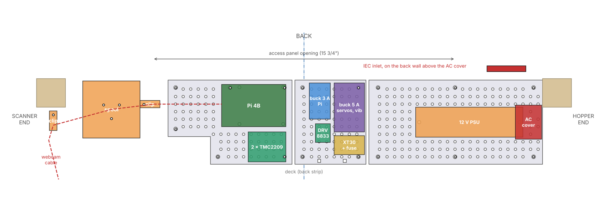
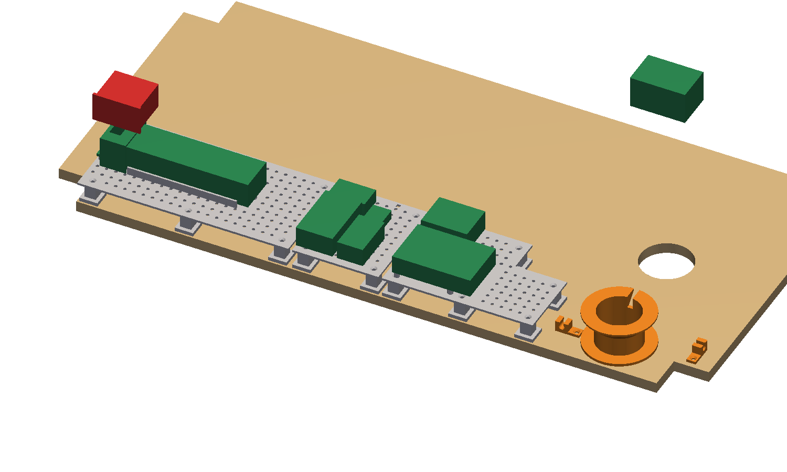
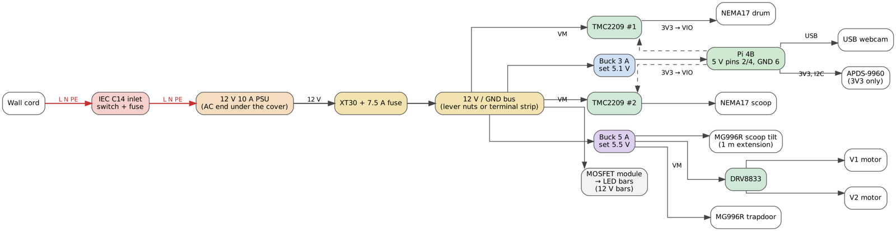

# Electronics: trays, power and wiring

Three trays on the back strip of the deck, behind the access panel. Mains comes in through the IEC inlet on the back wall.
Printed: P18 (trays 1a/1b/2, PSU cover, 16 legs), P13 (cable spool, clips). CAD: branch `cad-v14-deck5`, `cad/v14/deck/`.

> **Mains (120 V) is dangerous.** Unplugged whenever you work on it. Insulated crimp terminals and heat shrink on every AC joint, the PSU cover on before power. Have someone who has wired mains before check it before the first plug-in.

## Hardware

| What | Qty | Use |
|---|---|---|
| #6 × **1 1/4** wood screw | 16 | trays through the legs into the deck (3/4 is too short) |
| M3 × 8 + washer | 2 | PSU end tabs into the tray 1a inserts |
| M3 × 8 | 2 | PSU AC cover |
| M3 nylon standoff kit | | boards on the 10 mm grid of trays 1b and 2 |
| M2 × 16 + nut | 4 | Pi 4B (nuts in the traps under tray 2) |
| #6 × 3/4 | 5 | cable clips 2, spool 3 (if not done in Identify) |
| 18 AWG, rated for mains | ~1 ft | inlet to PSU (L, N, earth) |
| 18 AWG red/black | ~3 ft | PSU → fuse → 12 V bus, bus → bucks |
| 20–22 AWG | | 5 V rail to servos and DRV8833 |
| Dupont / 24–26 AWG | | signals |
| Lever nuts or a terminal strip | | 12 V and GND bus |

## 0. Layout

| Tray | From the X line | Holds |
|---|---|---|
| 1a | 3 3/8 to 12 7/16 in toward the hopper end | PSU, AC end at the hopper end, under the inlet |
| 1b | 3 1/4 in toward the hopper end to 1/2 in toward the scanner end | 5 A buck, 3 A buck, XT30 + fuse, DRV8833 |
| 2 | 5/8 to 7 1/16 in toward the scanner end | Pi 4B (USB end toward the scanner), 2 × TMC2209 |

All three: back edge about 1/16 in in from the deck's back edge, front edge about 2 3/8 in behind the Y line.

1. Keep tray 1a's end legs **1/8 in clear of the hopper-end posts**. Slide the trays toward the scanner end if needed; there is 1/8 in between trays.
2. Tray 2's L-shape clears the scanner's foot 1.
3. Pilots 3/32 in, #6 × 1 1/4 through each tray hole and its leg into the deck.

## 1. Mount

1. **PSU** on tray 1a's two rails, AC terminals at the hopper end. 2 × M3 × 8 + washers through the end tabs into the inserts.
2. **AC cover 227** over the AC terminals after wiring (2 × M3 × 8).
3. **Boards** on standoffs wherever they fit on the grid: 1b = both bucks, XT30 + fuse, DRV8833. 2 = Pi (M2 × 16, nuts underneath), TMC2209 carrier.
4. **IEC inlet** snaps into the back wall tile B c1 r3 (hopper end, top row). Measure your inlet first: the cutout is drawn **47.5 × 27.5 mm**. File it if the module is bigger.

## 2. Power

1. **AC:** inlet L, N, earth → PSU L, N, ⏚. Female insulated spades on the inlet tabs, forks on the PSU screws. Leave slack so the cover fits.
2. **12 V:** PSU V+ / V− → XT30 → **7.5 A fuse** → 12 V bus.
3. From the bus: both TMC2209 VM, both buck inputs, the LED bar MOSFET (if 12 V bars).
4. **Set the bucks with a meter before anything is connected to them:** 5 A buck **5.5 V** (servos, DRV8833), 3 A buck **5.1 V** (Pi).
5. **Pi power:** 3 A buck → Pi pin 2 or 4 (5 V) and pin 6 (GND). This skips the Pi's USB-C fuse: never plug USB-C power in at the same time.
6. **One ground:** every GND goes back to the bus.

## 3. Drivers

- **TMC2209:** VIO from the Pi's 3V3 (pin 1). Leave MS1/MS2 open (1/8 step). EN is on when low.
- **Current:** on the BTT board, peak current = Vref. Start at **Vref 0.8 V** (about 0.57 A rms). Raise 0.1 V at a time only if the motor skips; it should stay warm, not too hot to touch.
- **DRV8833:** VM from the 5 A buck. If the board has a SLP / EEP / STBY pin, tie it to 3V3.
- **Motor pairs:** find each NEMA17's coil pairs with a meter (continuity) before plugging into the driver.

## 4. Signals (proposed, confirm with Ethan, Vivek and Marshall before soldering)

| Signal | GPIO (BCM) | Pi pin | Notes |
|---|---|---|---|
| Drum STEP / DIR | 17 / 27 | 11 / 13 | TMC2209 #1 |
| Scoop STEP / DIR | 22 / 5 | 15 / 29 | TMC2209 #2 |
| Both EN | 6 | 31 | low = on |
| Scoop home switch | 26 | 37 | C → GND, NO → pin, pull-up (same rule as the bin switches) |
| Trapdoor servo | 12 | 32 | signal only; power from the 5 A buck |
| Scoop tilt servo | 13 | 33 | via the 1 m extension |
| V1 motor | 18 | 12 | DRV8833 AIN1, AIN2 → GND |
| V2 motor | 19 | 35 | DRV8833 BIN1, BIN2 → GND |
| LED bars | 4 | 7 | MOSFET module input |
| APDS-9960 SDA / SCL | 2 / 3 | 3 / 5 | 3V3 pin 17, GND pin 9 |
| Bin switches (existing) | 23, 24, 25, 16, 20 | 16, 18, 22, 36, 38 | Ethan's, unchanged |
| Webcam | USB | | Pi USB port nearest the scanner |

Servos and vibration motors: run them with pigpio (steady pulses on any pin).

## 5. Cable routes

- **Webcam:** bridge post → plate corner → clip 226-1 → spool 228 (~1 m slack) → clip 226-2 → Pi.
- **Scoop** (motor, home switch, tilt servo): down through the gap between the deck's hopper end and the end cleat (open at that end; the filler strip is at the scanner end). The scoop motor and home switch are right below.
- Keep AC wires on the hopper end only, away from signal wires.

## 6. Checks (in this order)

1. Unplugged: meter beeps from the inlet's earth pin to the PSU ⏚ and the PSU case. No beep between 12 V and GND on the bus.
2. Plug in with nothing on the bucks: PSU 12.0 V, bucks 5.5 / 5.1 V.
3. Pi alone on the 3 A buck: boots, no undervoltage warning.
4. One driver at a time: drum turns, scoop moves, servos move, trays buzz.
5. Fuse and PSU stay cool after 10 minutes of everything running.
