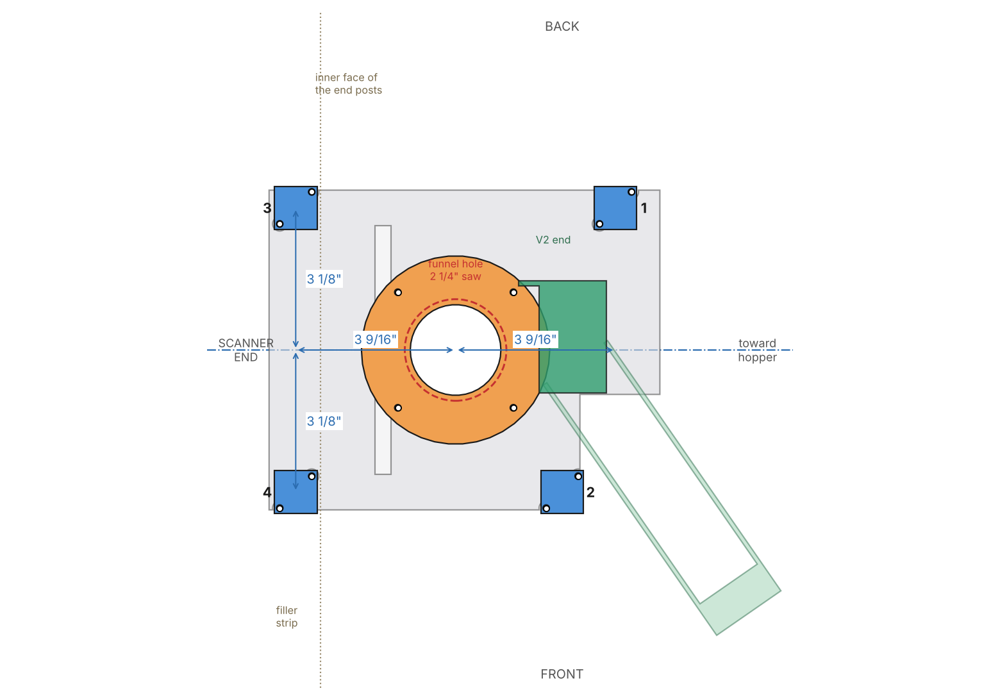
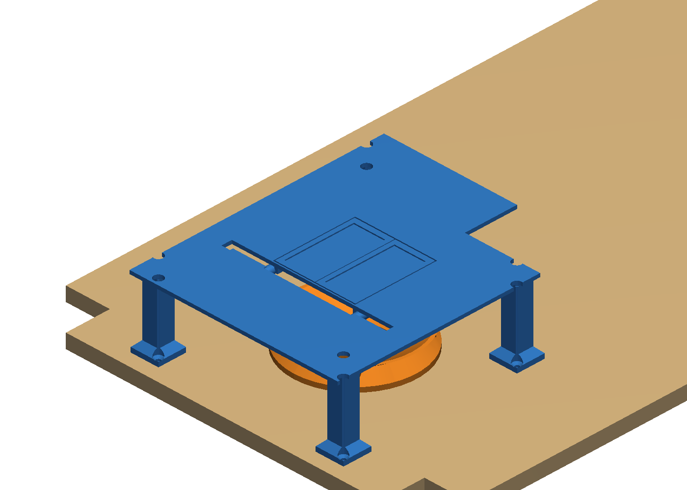
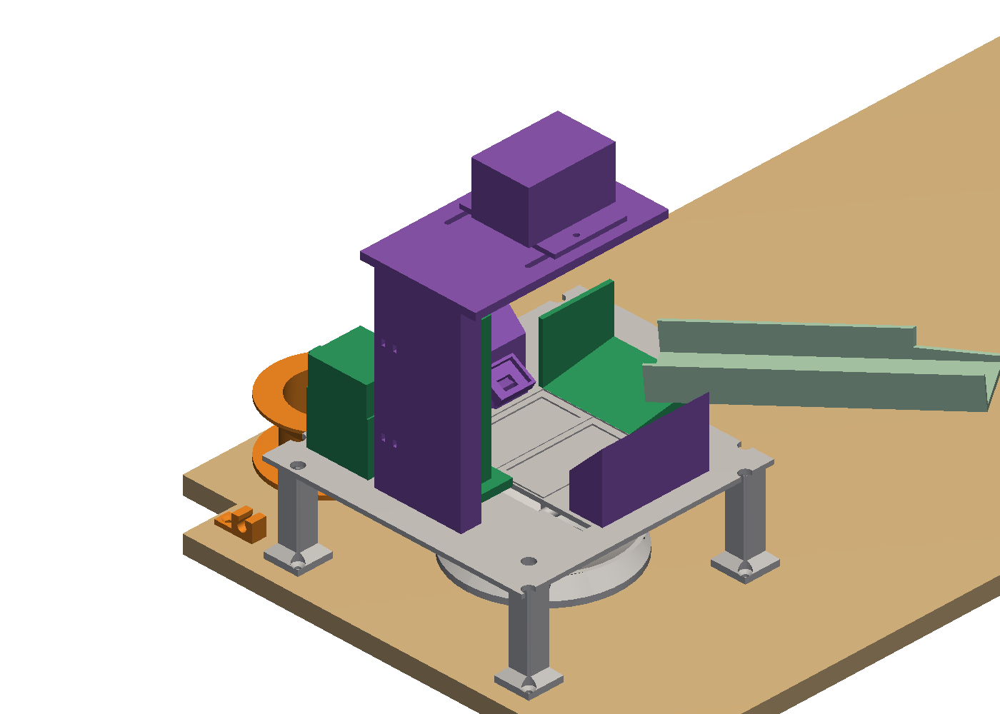
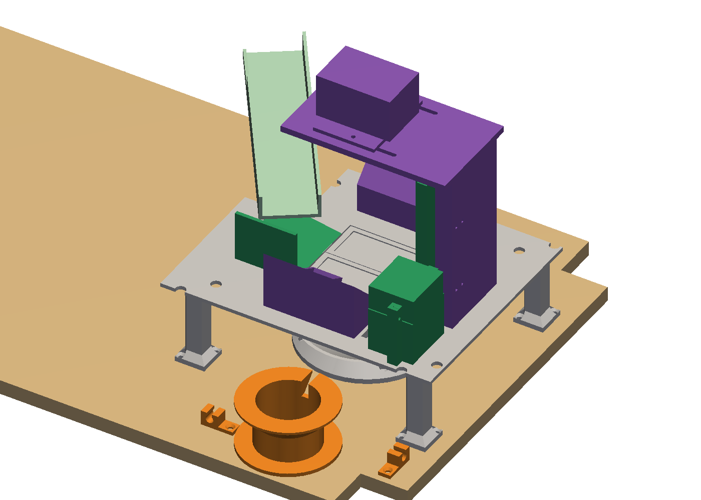

# Identify: scanner on the deck

Funnel, scanner plate with the trapdoors, door linkage and servo, camera bridge, webcam, LED bars, colour sensor.
Printed: P13, P16, P18, P19. CAD: branch `cad-v14-deck5`, `cad/v14/deck/` (the linkage parts 57d, 59, 59b, 60 are V13 reuse, `cad/reference_v13/`).

Same names as the Isolate guide: **front** = logo side, **hopper end** / **scanner end**, X and Y centre lines on the deck.

## Rules

- The **funnel hole is the reference** for everything here. The plate centres on the funnel; it is not measured from the deck edges.
- Small parts on the plate (post, bridge, LED holders, colour sensor): CA glue, or drill **2.5 mm** into the part and drive an M3 from below (self-taps in PETG).
- Pins in the linkage: M3 + nyloc, snug but free. Nothing in the door path may bind.

## Hardware

| What | Qty | Use |
|---|---|---|
| #6 × 3/4 wood screw | 17 | funnel 4, plate feet 8, cable clips 2, spool 3 |
| M3 × 16 + nut | 4 | trapdoor pivots |
| M3 × 12 + nyloc | 4 | link pins (door levers 2, slider servo pin 1, horn arm 1) |
| M3 × 16 + nyloc | 1 | slider door pin (both door links on it) |
| M3 × 12 + nut | 8 | servo ears 4, saddle to plate 2, webcam mount to bridge 2 |
| M3 × 16 (self-tap) or CA | ~6 | slider post, bridge posts, colour sensor mount |
| Zip ties (small) | 6 | webcam strap 2, cable on the bridge post 4 |
| Hole saw **2 1/4 in** | | funnel hole (the funnel tube is 55 mm, just under 2 3/16 in; a 2 3/16 in hole leaves only 1/64 in against the wood) |

## 0. Funnel hole

Centre: on the Y line, **9 7/16 in** toward the scanner end from the X line. Cut it **2 1/4 in**. If a 2 3/16 in hole is already there, open it up with a rasp until the funnel drops in freely.

## 1. Plate on the bench (upside down)

1. **Doors:** each door's barrel sits between two lugs under the plate. M3 × 16 through each lug from outside, nut on the **inside** face of the lug, the screw tip goes into the barrel as the pin (4 pivots).
2. Both doors swing free and close flat with the plate top.
3. **Slider post 212** on the plate at the scanner-end side of the window (its base is 15/16 × 1 5/16 in). Glue or 2 × M3 from below.
4. **Slider 57d** onto the post's dovetail. It must slide down by its own weight; sand the post if it sticks.
5. **Door links 59:** one from each door's lever pin to the slider's door pin. Pushing the slider down opens both doors.

## 2. Servo

1. MG996R into **saddle 213** (4 × M3 × 12 + nut through the ears).
2. Saddle on the plate on the back side of the window. Mark its 2 holes through the plate, drill 1/8 in, M3 × 12 + nut.
3. **Set the servo to its "closed" angle first** (the angle the code will use), then fit **horn arm 60** on the stock horn.
4. **Servo link 59b** from the arm pin to the slider's servo pin.
5. Move the servo by code: doors open fully and close flat, no binding.

## 3. On the deck

1. **Funnel 220:** tube down through the hole, flange flat on the deck, 4 × #6 × 3/4 (3/32 pilots, driver down the bores in the cone).
2. **Plate:** stand it on its 4 feet with the window centred over the funnel mouth.

| Foot | From the funnel centre (check only) |
|---|---|
| 1 | 3 9/16 in toward the hopper end, 3 1/8 in back |
| 2 | 2 3/8 in toward the hopper end, 3 1/8 in front |
| 3 | 3 9/16 in toward the scanner end, 3 1/8 in back |
| 4 | 3 9/16 in toward the scanner end, 3 1/8 in front |

3. Feet 3 and 4 land on the **filler strip** at the scanner end (past the inner face of the end posts). All 4 feet must sit flat: shim a rocking foot with card or a washer.
4. Pilots through the 8 foot holes (the plate has driver holes above them), #6 × 3/4.
5. Open the doors by hand: the door tips clear the funnel mouth (CAD: only 1/32 in). If they touch, shim all 4 feet up 1/16 in.

## 4. Top parts

1. **Landing ramp 211** under V2's low end, sloping down toward the doors, its tall wall on the back side. Glue it only after V2 delivers pieces onto it and they slide onto the closed doors.
2. **LED holders 216 A/B** on the front and back of the window. LED bars clip in at 45°. Glue.
3. **Camera bridge 215:** its post at the scanner-end side of the window. Glue or 2 × M3 from below through the plate.
4. **Webcam** face down on **mount 217**, lens over the bridge hole, 2 zip ties. Mount 217 to the bridge with 2 × M3 in the slots (slide it until the lens is centred over the doors). Lens to doors: about **5 in**.
5. **Colour sensor (APDS-9960)** in **mount 218** on the back side of the window, tilted toward the door centre. **3V3 only.**
6. **Webcam cable:** zip-tie through the 2 slot pairs on the bridge post, over the plate corner, clip 226-1, about 1 m of slack wound on spool 228, clip 226-2, then to the Pi (Electronics guide).

## 5. Checks

- A piece dropped on V2 slides onto the ramp, then onto the closed doors, and stops in the window.
- Doors open: the piece falls through the funnel. With Indicate in, it lands in the scoop cup.
- Camera picture shows the whole window, in focus, with the LEDs on.
- Nothing in the linkage rubs the bridge, the LED holders or the saddle.
