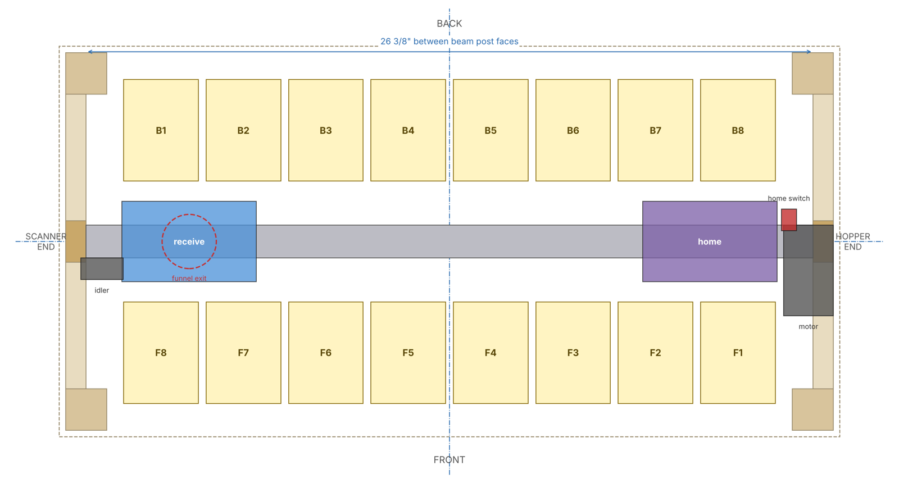
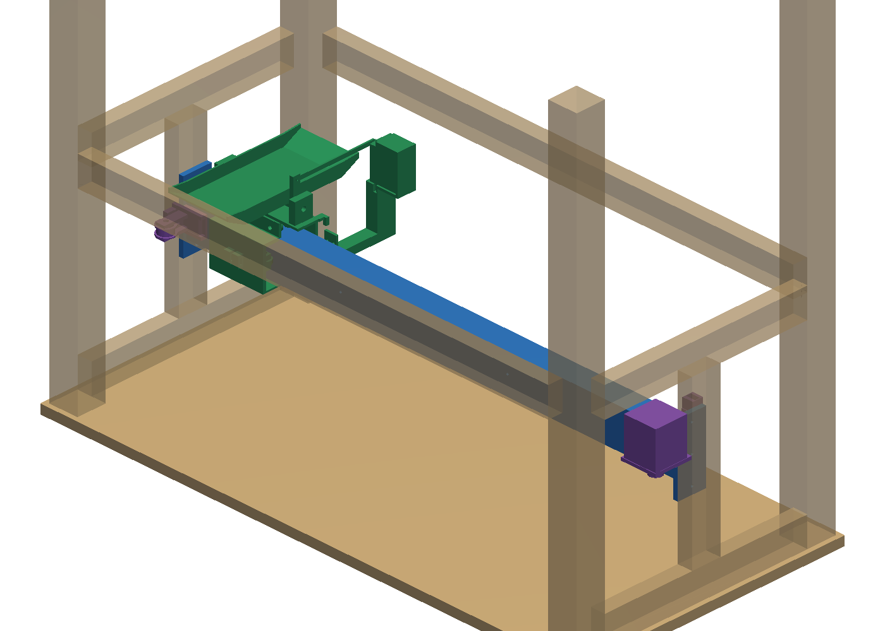
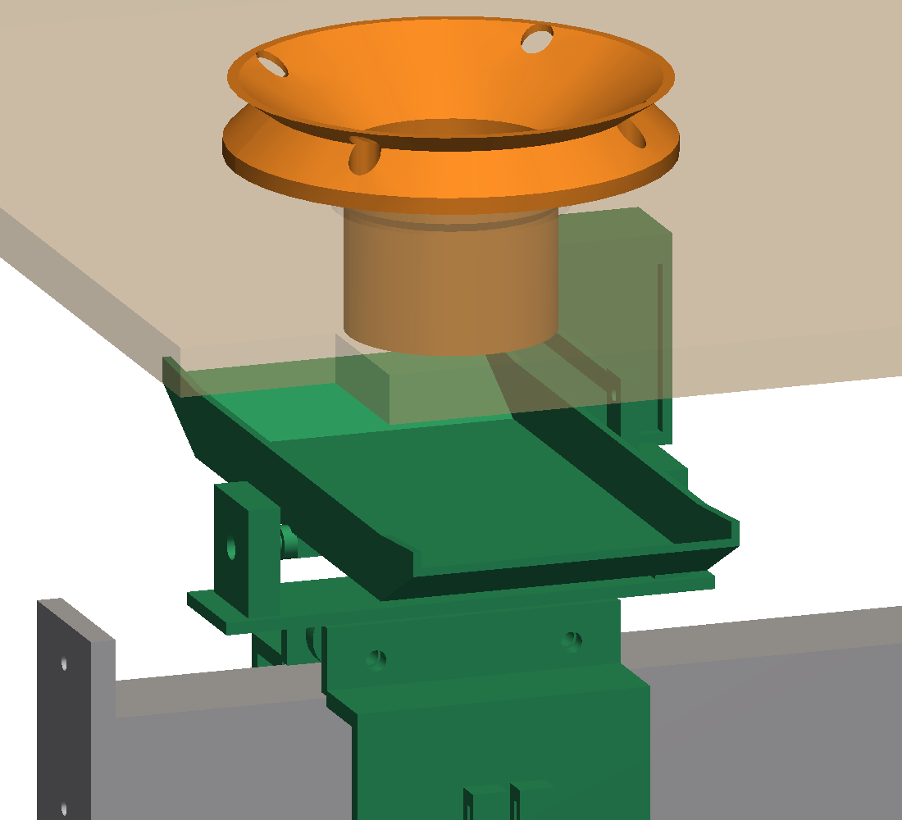

# Indicate: scoop and bins

Box beam between the two beam posts, carriage with the scoop cup, belt drive, home switch. For the POC the bins are 16 loose containers on the floor (the drawers come next semester).
Printed: P20 (beam, carriage, cup, drive parts), P21 (TPU cup pad, printing). CAD: branch `cad-v14-all`, `cad/v14/scoop/`.

Same names as the other guides: **front** = logo side, **hopper end** / **scanner end**.

## Rules

- The beam is a **fixed length** (26 3/8 in with its end plates). Measure the wood before anything else (step 0).
- Carriage, belt and cup must move by hand with no binding before any motor is wired.
- The scoop's receive spot is set by the **funnel**, not by a tape measure: the cup goes under the funnel exit.

## Hardware

| What | Qty | Use |
|---|---|---|
| 625ZZ | 12 | carriage rollers 8 (one each), cup pivots 2, idler 1–2 |
| M5 × 50 + nyloc | 2 | top roller axles (2 rollers on each) |
| M5 × 30 + nyloc | 5 | side roller axles 4, idler axle 1 (25–30 mm all fit) |
| M3 × 12 + nut | 8 | motor bracket to beam, misc |
| M3 × 8 | 4 | NEMA17 to bracket 184 |
| M3 × 35 + nut, or CA | 2 | beam joints (one straight through each joint) |
| M3 × 20–30 + M3 insert | 1 | belt tensioner |
| #6 × 3/4 wood screw | 6 | end plates into the beam posts, 3 per end |
| M2 × 8 | 6 | servo horn, home switch |
| GT2 6 mm belt, 20T pulley (5 mm bore) | ~1.3 m, 1 | drive |
| PTFE tape | | anti-lift hooks |
| 1 m servo extension | 1 | tilt servo lead |

## 0. Measure the beam posts

The two **beam posts** are the 1x2s standing in the middle of each end, between the bottom rail and the end deck cleat.

Measure between their **inside faces**, about 6 in above the floor. The beam needs **26 3/8 in**.
- More than that: shim behind one end plate (washers or card) so both ends screw down without pulling the beam.
- Up to 1/16 in less: sand the outside faces of the end plates.
- More than 1/16 in less: stop and tell Claude.

## 1. Carriage and beam (bench)

1. Rollers: one 625ZZ in each of the 8. Top rollers: 2 axles (M5 × 50), 2 rollers on each. Side rollers: 4 × M5 × 30. Nylocs snug, every roller spins free.
2. PTFE tape on the 2 anti-lift hooks.
3. Plug the 3 beam segments together. Pin each joint: one M3 × 35 + nut straight through both side holes (or CA the plug).
4. Slide the carriage onto the beam from one end. It must roll the full length by hand with no tight spots.

## 2. Beam in

1. Beam between the beam posts, end plates flat on the inside faces, centred on the posts, beam level.
2. Motor end (motor bracket side) at the **hopper end**.
3. 3/32 pilots through the 3 holes in each end plate, #6 × 3/4.

## 3. Drive

1. **Motor:** bracket 184 over the beam top at the hopper end (2 × M3 × 12). NEMA17 sits on top of its plate, shaft pointing down through it (4 × M3 × 8). 20T pulley on the shaft under the plate (set screw on the flat), level with the carriage's belt clamp.
2. **Idler:** channel 185 at the scanner end, slider 186 with wheel 187 (625ZZ, M5 axle), tension screw into the insert.
3. **Belt:** loop around the pulley and the idler on the front side of the beam, both ends in the carriage's clamp arm, teeth meshed.
4. Tension with the screw until the belt is firm but the carriage still rolls end to end by hand (motor unpowered).
5. **Home switch:** KW11-3Z on mount 188 on the beam top at the hopper end, back side (2 × M2 × 8). The carriage flag presses it before the carriage touches the motor bracket.

## 4. Cup and tilt

1. Cup 182 stub axles into the tower bearings. TPU pad 183 on the cup floor (glue).
2. MG996R in bracket 190 on the back side of the carriage.
3. **Set the servo to "level" first** (the angle the code uses), then fit the horn and pushrod 189 to the cup crank. Cup floor flat at level.
4. Servo lead: 1 m extension as a rolling loop along the back face of the beam, one fixed clip at the beam middle.

## 5. Bins (POC)

16 containers, each up to **2 11/16 in wide × 3 11/16 in deep × 4 1/2 in tall**, on the floor.

| | Centres from the X line | Rows |
|---|---|---|
| Columns | 1 1/2, 4 1/2, 7 1/2, 10 1/2 in, both sides | Front row and back row, centred **4 1/16 in** from the Y line |
| Names | F1 at the hopper end → F8 at the scanner end | B1 at the scanner end → B8 at the hopper end |

## 6. Checks

- Carriage runs end to end by hand: no rub on the posts, the end plates or the containers.
- **Receive spot:** move the carriage under the funnel. The funnel exit is centred over the cup, about 1 11/16 in above the cup floor. Mark this spot on the beam (CAD: 9 7/16 in toward the scanner end from the X line).
- Tilt front and back: a piece slides off into the front or back container, not onto the floor.
- Home switch clicks before anything hits.
