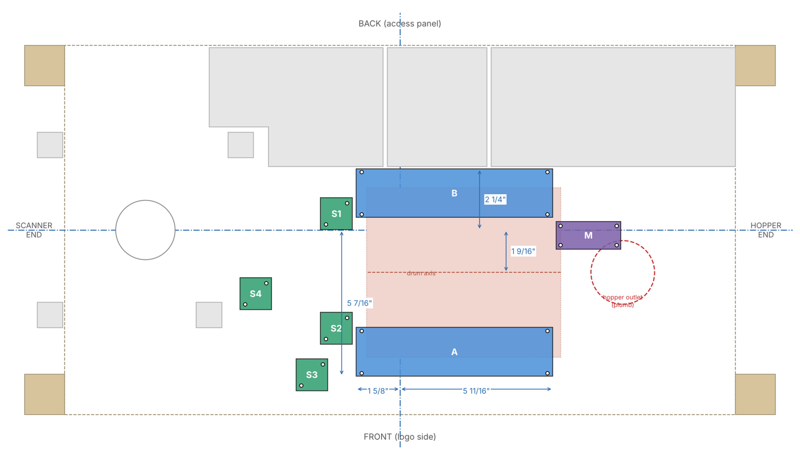
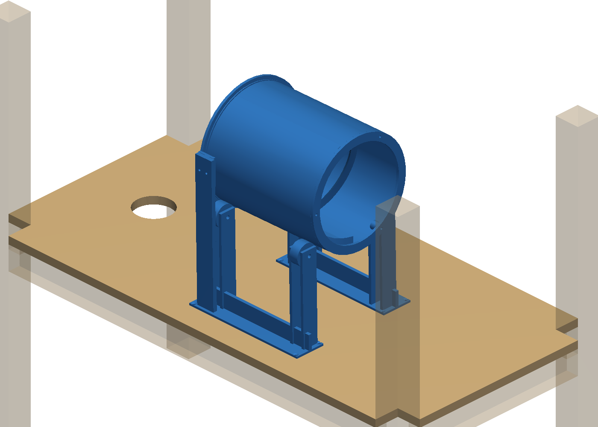
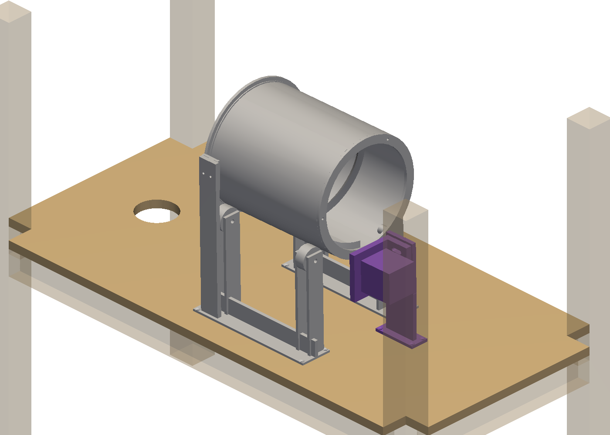
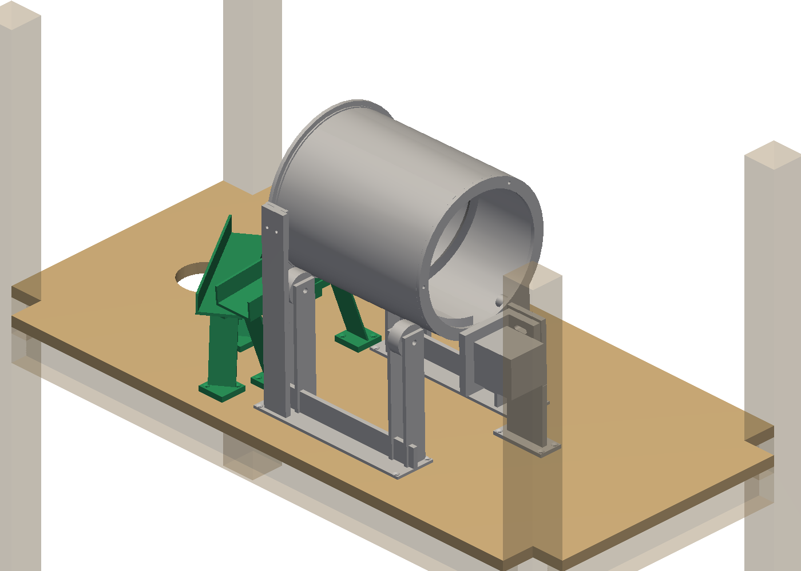
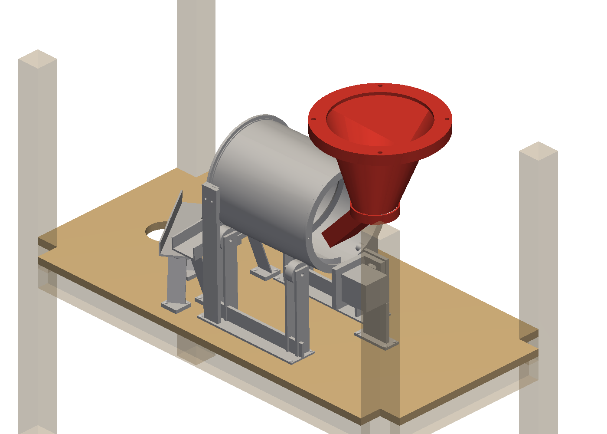
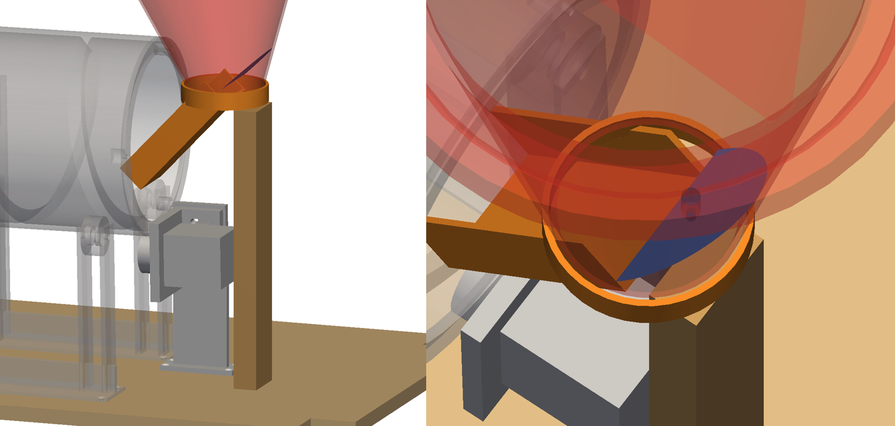

# Isolate: mounting on the deck

Drum, drive, V1/V2 trays and the feed (hopper + chute). Everything here is printed (P11–P19). The chute is used as printed, with a scrap block and a card deflector (section 5).
CAD: branch `cad-v14-deck5`, `cad/v14/deck/` (`parts.json` has every screw position).

Sides are named the same way everywhere below:
- **Front** = logo side. **Back** = access panel side.
- **Hopper end** = the end under the stud that holds the hopper. **Scanner end** = the end with the funnel hole.

## Rules for this deck

- The deck was cut to fit between the posts, so its edges are not reference faces. Everything is measured from **two centre lines** (step 0).
- No pre-drilled pattern. Put the part where it goes, check it, then drill pilots **through the part's own holes**.
- Pilots: **3/32 in** for #6 wood screws.
- Leave **at least 1/8 in** between anything that vibrates (trays) and anything else.

## Hardware

| What | Qty | Use |
|---|---|---|
| 625ZZ bearing | 8 | 2 per drum roller |
| M5 × 30 socket head + nyloc | 4 | roller axles through the cradle forks |
| M3 × 12 + nut | 4 | outlet plate 49b ears to the cradle cheeks |
| M5 × 16 + nut | 4 | motor bracket 56 to motor wall 206 |
| M3 × 8 | 4 | NEMA17 to bracket 56 |
| M3 × 12 flat head + nut | 8 | leaf spring pads to the tray floors |
| #6 × 3/4 in wood screw | 20 | cradles 8, motor wall 4, springs 8 |
| M3 × 8 flat head | 4 | hopper flange into the stud inserts |
| 1x2 offcut (~9 in), thin card, hot glue | | chute support block and deflector |
| Drill bits | | 3/32 in (pilots), 1/8 in (M3 through the tray floors) |

## 0. Centre lines

1. Roof off.
2. **X line** (front to back): measure between the inside faces of the two posts at the front, mark the middle. Same at the back. Snap or draw the line.
3. **Y line** (end to end): measure the deck front to back near the hopper end, mark the middle. Same near the scanner end. Draw the line.
4. Check: the funnel hole centre should sit on the Y line, about **9 7/16 in** toward the scanner end. If it is off by more than 1/8 in, tell Claude before going on.

All dimensions in the drawing are from these two lines.

## 1. Drum unit (on the bench, not on the deck)

1. Press 2 × 625ZZ into each roller (4 rollers).
2. Roller axles: M5 × 30 through each cradle fork + nyloc. Snug, roller still spins free.
3. Outlet plate 49b: ears onto the cheeks of cradles A and B, M3 × 12 + nut, 2 per side.
4. Rear guard 48 on the barrel's back end.
5. Set barrel 47b on the 4 rollers, front end against the 49b thrust ring.
6. Spin it by hand: free, no rubbing. If the bosses drag on the thrust ring, wax it (or a PTFE ring).

## 2. Place the drum unit

| Edge | From | Distance |
|---|---|---|
| Cradle bases, hopper-end edge | X line, toward hopper end | **5 11/16 in** |
| Cradle bases, scanner-end edge | X line, toward scanner end | **1 5/8 in** |
| Cradle A (front), front edge | Y line, toward front | **5 7/16 in** |
| Cradle B (back), back edge | Y line, toward back | **2 1/4 in** |
| Drum axis (check) | Y line, toward front | 1 9/16 in |

Drill 3/32 in pilots through the 8 cradle holes, #6 × 3/4.

## 3. Drive

1. NEMA17 onto bracket 56 (4 × M3 × 8). Drive core 54 on the shaft (drill 5 mm if tight), TPU tire 55 on the core.
2. Bracket 56 to motor wall 206: 4 × M5 × 16 + nut, loose for now.
3. Stand the wall behind the drum (purple **M** in the drawing, ~6 in from the X line toward the hopper end). The tire presses **up** on the barrel underside at the back end.
4. Slide the bracket in its slots for light contact. Tighten.
5. Pilots through the 4 foot holes, #6 × 3/4.
6. Turn the motor shaft by hand: the drum turns, the tire does not slip.

## 4. Trays

1. Each tray gets its 2 leaf springs (V1: S1, S2. V2: S3, S4). Mark through the pad holes onto the tray underside, drill 1/8 in, M3 × 12 flat head from **inside** the tray (flush, nothing for a piece to catch on), nut under the pad.
2. Stand V1 in front of the outlet plate. Its back wall is **1/16 – 1/8 in** off the plate face (must not touch when it vibrates).
3. Stand V2 so V1's low end sits over V2's notch, and V2's low end points at the scanner landing ramp.
4. Check 1/8 in clearance all around both trays. Pilots through the spring feet, #6 × 3/4.

Spring foot holes from the centre lines, in inches (check only; place by steps 2–3, not by these):

| Spring | Hole 1 | Hole 2 |
|---|---|---|
| S1 (V1 back) | 1 15/16 scanner, 1 back | 2 3/4 scanner, 3/16 back |
| S2 (V1 front) | 1 15/16 scanner, 3 1/4 front | 2 3/4 scanner, 4 1/16 front |
| S3 (V2 high end) | 2 7/8 scanner, 5 front | 3 11/16 scanner, 5 3/4 front |
| S4 (V2 low end) | 4 15/16 scanner, 1 15/16 front | 5 3/4 scanner, 2 3/4 front |

Vibration motor saddles (62/63) go on the tray undersides when the motors arrive (see `buy-list.md`).

## 5. Feed (hopper + chute): as printed, no redesign

The printed chute (P12) has two gaps. Both are fixed here with scrap, no reprint:
- About **38 %** of the hopper outlet has no chute under it (white area below, seen from underneath). Pieces there would fall onto the motor.
- Nothing holds the chute up. Its ring only sits under the hopper.

**Support block** (tan above)
1. 1x2 offcut, on end, about **9 in** tall.
2. Stand it on the drum axis line (1 9/16 in toward the front of the Y line), **8 13/16 to 9 9/16 in** toward the hopper end from the X line. The 1 1/2 in face runs front to back.
3. It stays about **3/8 in** clear of the drum motor.
4. Set the chute in place: its ring sits on the block top and the trough tip goes just inside the drum's back opening. The tip must not touch the turning drum.
5. Trim the block until the ring top sits **about 1/8 in under** the hopper outlet with the hopper in.
6. Hot glue the block to the deck and the ring to the block.

**Deflector** (blue above)
1. Thin card or plastic, about **1 1/2 × 2 1/4 in**. Trim one end to the hopper's curve.
2. Glue it inside the hopper outlet on the hopper-end side, sloping down about **45°** toward the drum.
3. Its low edge sits about **1/4 in behind the outlet centre** (toward the hopper end). That puts the edge right over the start of the chute floor.
4. Big plates may jam in the smaller opening. Test with your largest pieces.

**Hopper:** in the stud, 4 × M3 × 8 flat head.

**Check:** drop 20 mixed pieces into the hopper with the drum turning. All 20 must land in the drum. Look up from below through the outlet: you should only see chute.

## 6. Checks (roof back on)

- Spin the drum 2 turns by hand: no rubbing on the roof cross rail (CAD has only **3/16 in** there).
- Plumb (string + nut) from the hopper outlet centre: it lands on the drum axis line, within 1/8 in.
- Nothing within 1/8 in of either tray.
- Note any gap or rub with a photo so the CAD can be updated.
