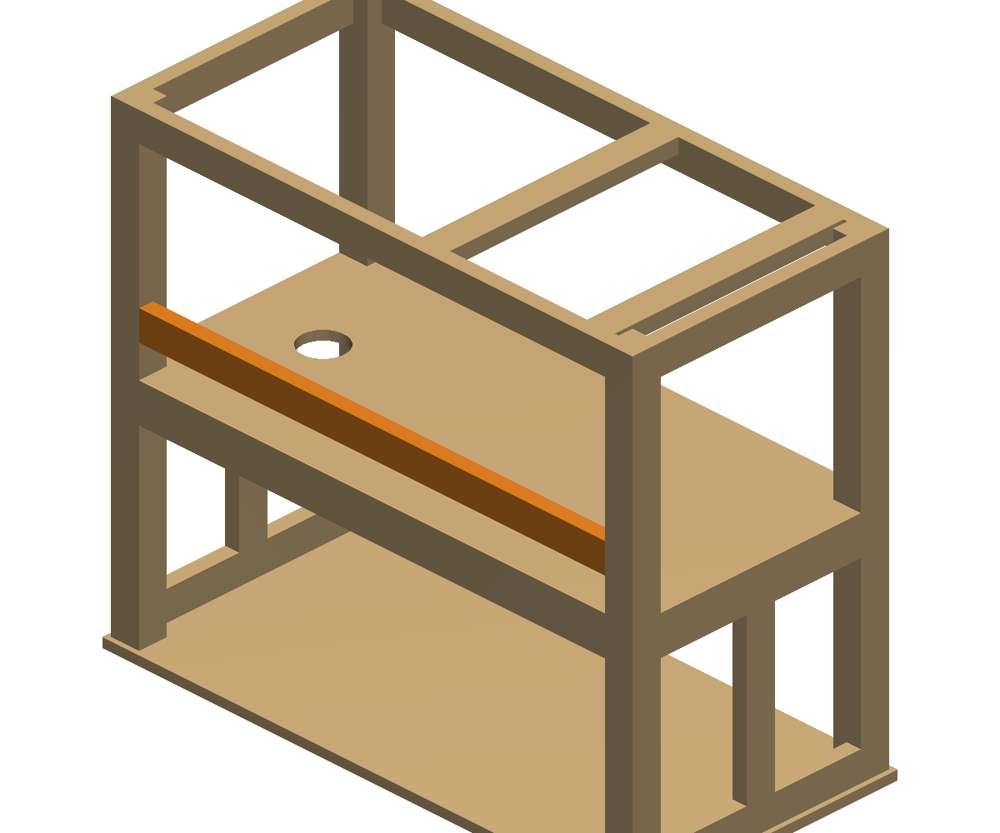
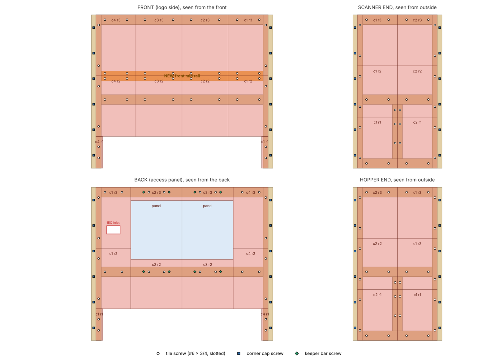
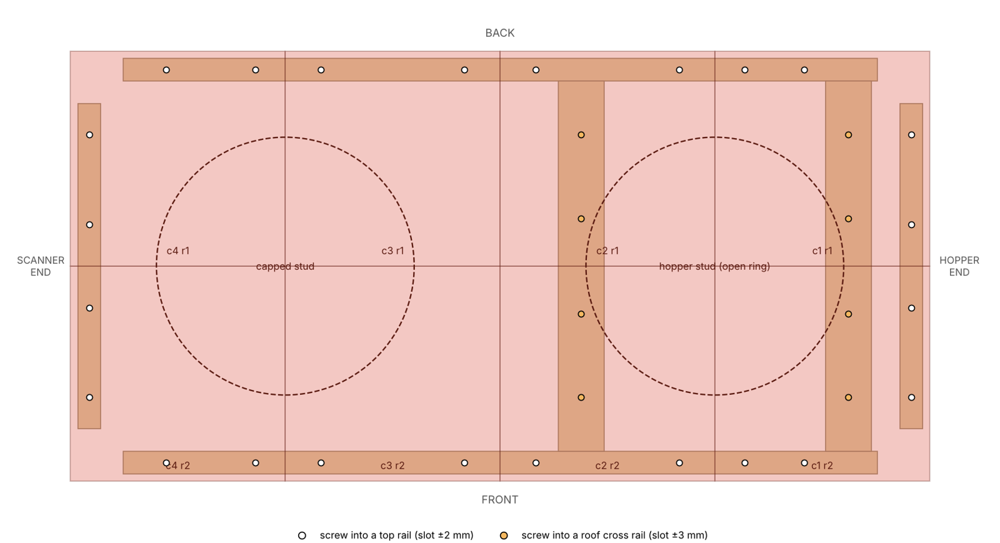
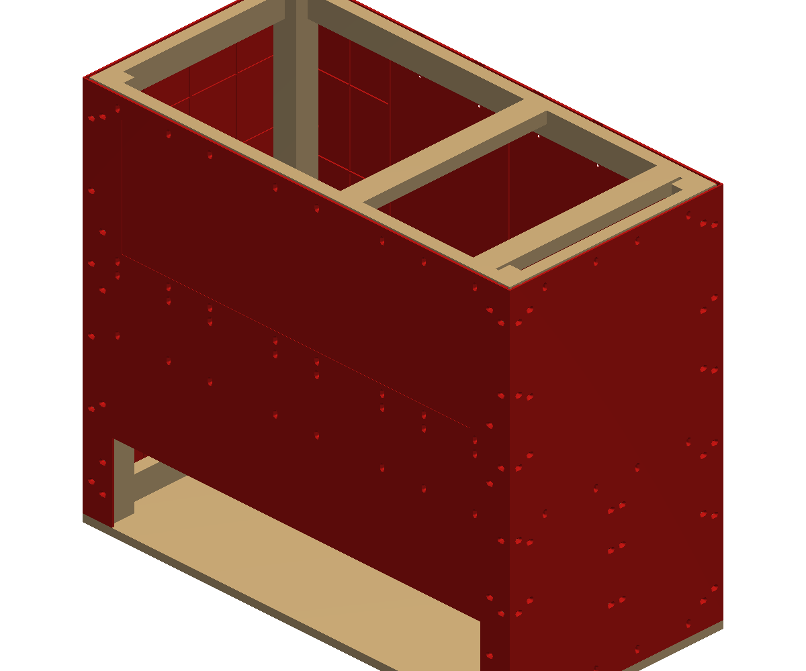

# Skin: walls, corner caps, access panel, roof

Red PLA tiles screwed straight to the wood. No clips. Every hole is a **slot** (±2 mm on the walls and the top rails, ±3 mm on the roof cross rails), so the tiles can follow the real wood.
Print files: `walls/` P25 v3 (34 tiles and panel halves), P10 v2 (12 corner caps), **P26 v1 (8 keeper bars, new)**; `1_now/` P22 v2 (8 roof tiles). Studs P8/P9 are done. CAD: branch `cad-v14-frame5`, `cad/v14/frame/` (`drilling_map.md` lists every screw).

Tile names: F front, B back, **L = scanner end, R = hopper end**. On F and B, c1 is at the hopper end; on L and R, c1 is at the back. r1 bottom, r3 top.

## Rules

- Pilot **3/32 in** at the centre of each slot, #6 × 3/4 flat head.
- Snug only: stop when the head seats. PLA cracks if you keep going.
- Tiles butt edge to edge. If the wood is off and a seam would overlap, leave a small even gap instead of forcing it.
- Work from the **top down** on each wall: the top edge of the top rail is the reference.

## Hardware

| What | Qty | Use |
|---|---|---|
| #6 × 3/4 flat head | 220 | wall tiles 132, corner caps 48, roof 32, keeper bars 8 |
| #9 × 2 1/2 | 4 | front mid rail, 2 per end |
| M3 heat-set inserts | 8 | keeper bars (one each) |
| M3 × 8 flat head | 16 | access panel 8, studs through the roof 8 |

## 0. New wood: front mid rail

1. 1x2, cut to fit between the two front posts (about 24 7/8 in). Measure at the rail's height, not at the floor.
2. Flush with the posts' outside faces.
3. Its **centre is 9 7/16 in below the top edge of the front top rail** (its top edge 8 11/16 in below).
4. 2 × #9 × 2 1/2 per end through the post, like the other rails (3/16 in clearance hole in the post, 9/64 in pilot in the rail end).

The front r2/r3 tiles both screw into it, 3/8 in from its edges. Too high or too low and those screws miss.

## 1. Walls

Every screw is a dot in the drawing (from outside each wall). Squares = corner caps, diamonds = keeper bars.

1. **r3 (top row):** top edge flush with the top of the top rail. End tiles stop **11/16 in** short of the outer corner; the corner cap covers that strip.
2. **r2**, then **r1**. On the front and back, r1 is only the narrow strips beside the drawer opening.
3. **Front top row last:** F c1–c4 r3 carry the logo. Check the logo pieces line up across the 3 seams before screwing.
4. **Back, hopper end, top (B c1 r3):** snap the IEC inlet in and wire it first (Electronics guide).
5. **Ends (L, R):** 6 tiles each. The middle seam sits over the beam post.

## 2. Access panel (back)

1. Heat-set an M3 insert in each keeper bar (P26).
2. 4 bottom bars on the back deck cleat, 4 top bars on the back top rail, at **1 15/16 in and 5 7/8 in** either side of the X line. One #6 × 3/4 each. The tiles around the opening are already shaped to clear them.
3. Panel halves: 8 × M3 × 8 flat head into the inserts.

## 3. Corner caps

12 caps, 3 per corner (r1, r2, r3). 4 × #6 × 3/4 each into the posts through the slotted pads. Caps go on after both walls at that corner.

## 4. Roof

1. **On a table:** lay tiles c1 + c2 (r1 and r2) face up as one square around the hopper hole. Screw the hopper stud on from below: 4 × M3 × 8 flat head through the tiles into the stud foot inserts. Same for c3 + c4 with the capped stud.
2. Each 4-tile half goes on the rails as one piece. r1 tiles are at the back.
3. 32 × #6 × 3/4: white dots go into the top rails, orange dots into the two roof cross rails.
4. Each half lifts off for maintenance (16 screws).

## 5. Checks

- No tile is bowed by a screw. If one is, back that screw off a turn.
- Seams even, logo lined up across the 4 front top tiles.
- Access panel comes off and goes back with only its 8 M3s.
- Roof halves sit flat; the hopper drops into the stud and the drum still turns (Isolate checks).
